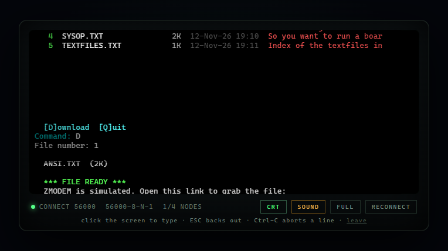

# THE MIDNIGHT GATE — a bulletin board system

A working, dependency-free BBS you can reach from a browser or a telnet client.
ANSI screens, message bases, private mail, file areas, door games, a live chat room
with bot callers, time limits, sysop paging, a voting booth — and a sysop console
in the browser for running the whole thing.

No npm install. Node 18+ and nothing else.



```bash
node server.js
```

- Web terminal: <http://localhost:8080/terminal>
- Landing page: <http://localhost:8080/>
- Sysop console: <http://localhost:8080/admin/> — default `sysop` / `sysop`
- Telnet: `telnet localhost 2323`

Sysop account: handle `SysOp`, password `sysop` (change it in *Your Settings* on the
board, and change the admin password from the console's Config page).

## What it actually does

**Calling in.** A dial-in sequence (`ATDT 867-5309` or `ATDT 555-0113`, picked per call),
ringback, answer tone, the full staged 14.4k handshake — played as real audio in the
browser from `public/audio/dialup.mp3` — a stage-by-stage reproduction of a real
dial-up call, rendered by `tools/make-dialup-audio.js` ([what each part
is](public/audio/CREDITS.md)). If that file is missing the board falls back to the
synthesised handshake: off-hook click, dial tone (350+440 Hz), DTMF for whichever number
was dialled, ringback (440+480 Hz), 2100 Hz ANSam answer tone with its 15 Hz warble, V.8
capability warble, V.21 handshake beeps, training sweeps and the final data hiss, all
band-limited to 300–3400 Hz. `?synth=1` forces the synth so you can hear both. Pressing a
key skips the sequence, exactly like the screen says. Then an ANSI welcome
screen, logon with handle + password, or `NEW` to register through the full questionnaire.

**On the board.** Main menu in the Telegard/Renegade style:

| | |
|---|---|
| `M` Message bases | read/post/reply, quoting, per-board access levels |
| `E` Private e-mail | inbox, send, reply, delete, unread counters |
| `F` File areas | list, download (web callers get a one-time link) |
| `D` Door games | native JS doors + zips dropped into `doors/install` |
| `C` Chat room | multi-node live chat, `/me`, `/w`, `/msg` |
| `W` Who is online | live node table, refreshes itself |
| `L` Last callers | the log everyone actually reads |
| `B` Bulletins | sysop announcements |
| `V` Voting booth | ballots with bar-graph results |
| `T` Time bank | trade posting credits for minutes |
| `R` Rumors & oneliners | the board's graffiti wall |
| `N` New files scan | newest uploads first |
| `Y` Your settings | password, signature, e-mail, ANSI |
| `S` System stats | calls, users, bytes, ASCII bar chart |
| `/` Page the sysop | lands in the console's page queue |
| `G` Goodbye | call summary, `NO CARRIER` |

Sessions have a time limit (60 min default, 30 for new users) with warnings at five
minutes, idle timeouts, ESC to abort a prompt and Ctrl-C to wipe an input line.

**Chat bots.** Five personas ship in `src/bots/bots.js`. They idle on nodes, post to
boards, reply to your messages, hang out in the chat room, leave one-liners and send
new callers private mail. With Ollama running locally (`llm.endpoint`, default
`http://127.0.0.1:11434/api/chat`) they write their own lines; without it they fall
back to a hand-written corpus so the board is never dead. Personas, chatter level and
the model are all editable in the console.

**Doors.** Nine playable doors ship built in: *Legend of the Red Dragon*, *Dragon's Keep*,
*Wasteland: Overkill*, *Barren Realms*, *Dominions*, *Trade Wars 3001*, *The Pit*,
*Blackjack* and *Freshwater Fishing*. To add one, drop a zip into `doors/install/` — the
scanner unpacks it, sniffs `FILE_ID.DIZ`/READMEs for the name and description, detects
`door.js` (native) or an `.EXE`/`.BAT` (DOS), writes `doors/<slug>/door.json`, and puts it
in the menu. See [docs/DOORS.md](docs/DOORS.md) for DOSBox/FOSSIL notes and the door API,
which also lives in [docs/DOOR_API.md](docs/DOOR_API.md). `npm run test:doors` drives every
built-in door with a scripted keyboard and fails on exceptions or writes outside 80x25.

**ANSI art.** Everything on screen is a drop-in file in `art/`: `WELCOME.ANS`,
`MAIN.ANS`, `GOODBYE.ANS` and the section banners (`MSG.ANS`, `FILES.ANS`, `DOORS.ANS`,
`CHAT.ANS`, `BULL.ANS`, `STATS.ANS`, `MAIL.ANS`, `LOGIN.ANS`, `NEWUSER.ANS`). Files may be
CP437 bytes or UTF-8; both load. Upload new art in the console, preview it, and assign
it to a slot. `node tools/make-art.js` regenerates the shipped set from code.

## Customising

`config.json` is created on first run and is the whole system configuration: board name,
sysop, location, node count, time limits, ports, ANSI slots, LLM endpoint/model, dial
numbers, door folder and scan interval, admin credentials. The console's Config page
edits it with dotted keys, or edit the file and restart.

Message boards, file areas, bulletins, bots, users and doors are managed in the console;
messages can be read and deleted there too, and files uploaded straight from the page.

## Layout

```
server.js              entry point (http + telnet + bots + door scan)
src/terminal.js        caller terminal: ANSI output, line/key input, echo, hangup
src/telnet.js          telnet negotiation (NAWS, ech, TTYPE), byte stream
src/ws.js              minimal RFC6455 server for the web terminal
src/http.js            static files, /api/status, /dl tickets, websocket
src/telnet.js …        one Terminal per caller, shared by both transports
src/flow/              the board: bbs.js (menu), login.js, messages.js, files.js,
                       chat.js, who.js, misc.js, screens.js (art + helpers)
src/doors/manager.js   discovery, manifests, menu, launching, drop files
src/doors/zip.js       zip reader (stored + deflate), path-safe extraction
src/doors/dropfiles.js DOOR.SYS / DORINFO1.DAT / CHAIN.TXT / CALLINFO.BBS
src/bots/              persona engine, corpus, Ollama client
src/admin-api.js       sysop REST API (docs/ADMIN_API.md)
public/                landing page, xterm.js terminal, admin console
art/                   ANSI screens
doors/                 installed doors + install/ drop folder
data/bbs.json          the database (JSON, atomic writes)
test/smoke.js          end-to-end test: boots the board, drives telnet, hits the API
```

## Tests

```bash
npm test        # or: node test/smoke.js
```

The smoke test boots a throwaway instance, logs in over telnet, posts a message, opens
the who's-online and door screens, registers a new user through the questionnaire, logs
off, then exercises the admin API and installs a door from a zip. 27 checks.

## Notes

- Windows, Linux and macOS all work; the only Windows-specific bits are optional.
- Ports: HTTP 8080, telnet 2323 (`PORT`/`TELNET_PORT` env vars override for tests).
  Port 23 needs admin rights — point a port forward or nginx stream at 2323.
- `data/bbs.json` is rewritten atomically every few seconds; back it up by copying it.
- The board is 80x25 by design. The web terminal scales the whole screen to fit rather
  than reflowing it, so the art stays exactly as drawn.
- `config.json` and `data/` are gitignored on purpose: they hold the admin password hash
  and caller data. A fresh clone starts from the defaults in `src/config.js`;
  `config.example.json` is a reference copy.

## Licence

MIT — see [LICENSE](LICENSE). The ANSI art, textfiles and game code in this repository are
original work written for this board. It is an homage to the BBS scene, not a copy of any
commercial door game; if you want the real *LORD*, *TradeWars* or *Operation: Overkill*,
install the original DOS door into `doors/install/` and run it under DOSBox.
