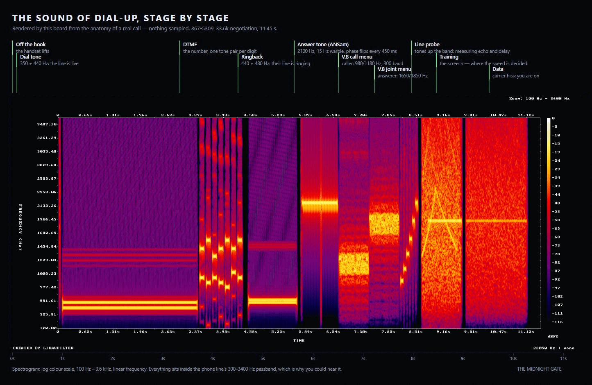

# The dial-up sound

`dialup.mp3` is **rendered by this repo**, not sampled from a recording:
`tools/make-dialup-audio.js` synthesises the handshake stage by stage and writes
a 22.05 kHz mono wav, then an mp3 if ffmpeg is present. Nothing third-party is
shipped, so there is no licence question over the audio.

```
npm run audio                              # 867-5309, 33.6k negotiation
node tools/make-dialup-audio.js --number 5550113 --bps 14400
node tools/check-dialup-audio.js           # measures each stage with a Goertzel filter
```

## What each part is



The order comes from what the sounds actually do, not from an impression of
them. The phone network carries 300–3400 Hz because that is where speech lives,
so every modem signal has to fit in that band — and is therefore audible. That
single fact is why connecting to the internet used to be something you could
hear from the next room.

| Time | Sound | What it is doing |
| --- | --- | --- |
| 0.00 s | click | the handset lifts |
| 0.08–3.28 s | 350 + 440 Hz | dial tone: the line is live, dial away |
| 3.34–4.39 s | pairs of tones | DTMF for the number dialled (`8` = 852 + 1336 Hz, `9` = 852 + 1477 Hz) |
| 4.50–5.60 s | 440 + 480 Hz | ringback: their line is ringing |
| 5.62–6.47 s | 2100 Hz, warble, little clicks | **ANSam**, the answer tone: their modem picked up. The tone is amplitude-modulated at 15 Hz and its phase flips 180° every 450 ms so that echo cancellers on the line cannot notch it out — the flips are the clicks |
| 6.50–7.20 s | 980/1180 Hz FSK, 300 baud | **V.8 call menu (CM)**: the caller lists the speeds and features it can do, on V.21 channel 1 |
| 7.22–7.92 s | 1650/1850 Hz FSK, 300 baud | **V.8 joint menu (JM)**: the answering modem replies on channel 2, and the two settle on a standard |
| 7.96–8.46 s | short tones stepping up | **line probe**: measuring response and delay across the band so a symbol rate can be chosen |
| 8.46–9.46 s | the screech | **training**: the equalisers converge. This is where the speed is decided, which is why people could hear whether a call would come up at 33.6k or crawl in at 14.4k |
| 9.51–11.45 s | band-limited hiss | **data**: you are on, and the line goes quiet-but-loud until the next packet or the next person picks up the phone |

Each stage is checked by frequency, not by ear: `node tools/check-dialup-audio.js`
runs a Goertzel filter over the rendered wav and asserts that the dial tone has
350 and 440 Hz, that the answer tone has 2100 Hz and its 15 Hz sidebands at 2085
and 2115 Hz, that the call menu really is on 980/1180 Hz and the joint menu on
1650/1850 Hz, and that the trailer is energy rather than silence. Thirteen checks,
same idea as reading the screen of a terminal test.

Sources for the anatomy: **["Sound of the dialup modem
explained"](https://www.youtube.com/watch?v=abapFJN6glo)** (bialasiczek, using
Oona Räisänen's [annotated
spectrogram](https://www.windytan.com/2012/11/the-sound-of-dialup-pictured.html)),
[What the dial-up sound was actually saying](https://www.youtube.com/watch?v=raik_i8VFvo)
(Mixed Signals), [Why did dialup modems make
noise?](https://superuser.com/questions/477358/why-dialup-modems-make-noise) on
Super User, and the ELI5 thread [Why did dialup modems make sound in the
90s?](https://www.reddit.com/r/explainlikeimfive/comments/1dcwa4d/).

## Using a real recording instead

Drop any file at `public/audio/dialup.mp3` (about 12 s suits the dial-in
sequence). Nothing else changes: the web terminal plays whatever is there and
falls back to the oscillator handshake in `public/terminal.js` when the file is
missing or cannot be decoded. `?synth=1` forces the synth so the two can be
compared.

The wav is a build artifact and is not committed; `npm run audio` regenerates it.
